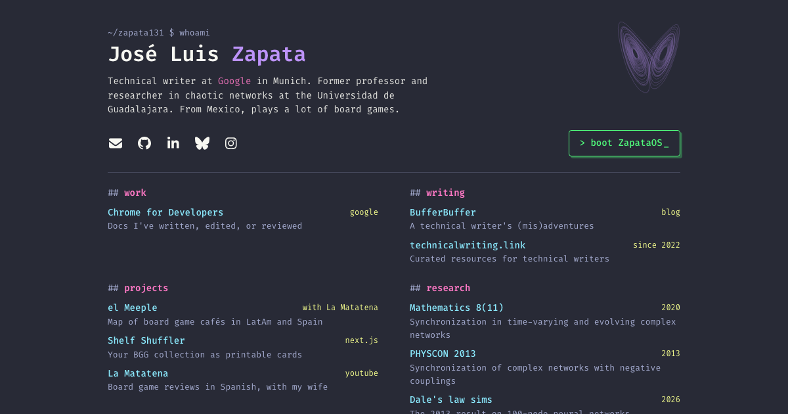

# zapata131.com

Source for [zapata131.com](https://zapata131.com), the personal page of José Luis Zapata: technical writer at
Google, former researcher in complex networks, board game person.

[](https://github.com/zapata131/zapata-landing-page/actions/workflows/.deploy.yml)



## What's here

```text
index.html      English page
es/index.html   Spanish page (shares styles.css and script.js)
styles.css      Layout and the Dracula/Alucard palette
script.js       Theme toggle and the random quote in the footer
assets/         Open Graph image and the Lorenz attractor drawing
desktop/        ZapataOS, a fake retro desktop linked from the footer
icons/          Favicon
```

Plain HTML, CSS, and JavaScript. No build step.

## Run it locally

```bash
python3 -m http.server 8000
```

Then open http://localhost:8000. Opening `index.html` straight from disk mostly works, but the CSS mask that draws
the attractor needs a server.

## Details worth knowing

- **Theme.** The page follows the system light/dark setting. The footer button overrides it and stores the
  choice in `localStorage` only when it differs from the system, so pressing it again goes back to following
  the system.
- **Languages.** Edit both `index.html` and `es/index.html` when content changes. They point to each other with
  `hreflang` links.
- **The drawing.** `assets/lorenz.svg` is the x–z projection of a Lorenz attractor (σ = 10, ρ = 28, β = 8/3),
  the system used in the 2013 negative-couplings paper. `script.js` replaces it with a canvas that integrates
  the system in 3D, spins it slowly, and traces the orbit with a bright point; you can drag it to turn it.
  With reduced motion or no JavaScript, the static SVG (a CSS mask in the accent color) stays.
- **ZapataOS.** The green button in the header boots it (boot screen once per session; any key skips).
  Apps: Identity, B-Sides, Research, Lorenz (3D attractor with a ρ slider), Dice (2d6 with a Catan
  histogram, 1d6, 3d6, 1d20), Network, Terminal, Trash.
  Yellow button or double-click on a title bar rolls a window up, Esc closes it, View > Clean Up Windows
  resets the layout. The terminal has history, Tab completion, `open <app>`, `roll 3d6`, `lorenz 20` and a
  few jokes; try `help`. Windows stack on phones.
- **Icons.** Contact icons are inline SVGs from [Font Awesome Free](https://fontawesome.com/license/free)
  (CC BY 4.0).

## Deploy

Every push to `master` runs [.github/workflows/.deploy.yml](.github/workflows/.deploy.yml), which uploads the
site over FTP. Work on a branch if you don't want changes to go live.

## License

MIT. Started as a fork of [madzadev/landing-page](https://github.com/madzadev/landing-page).
